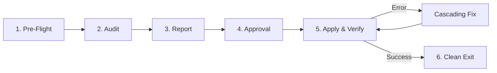

<p align="center">
  
</p>

<h1 align="center">CITADEL</h1>
<p align="center">
  <b>Autonomous Hardening & Threat Mitigation Engine for Windows 10/11</b>
</p>

<p align="center">
  <a href=".github/workflows/ci.yml"></a>
  
  
  
  
  <a href="LICENSE"></a>
  
</p>

<p align="center">
  <a href="#-quickstart">Quickstart</a> •
  <a href="#-security-vectors-22">Security Vectors</a> •
  <a href="#-how-citadel-works">How It Works</a> •
  <a href="#-architecture">Architecture</a> •
  <a href="#-testing--ci">Testing & CI</a> •
  <a href="#-contributing">Contributing</a>
</p>

---

## 🛡️ What is Citadel?

**Citadel** is an autonomous cybersecurity agent built natively for the **Google Antigravity** ecosystem. Unlike static, fragile PowerShell scripts that blindly apply settings and break on errors, Citadel operates as an **intelligent closed-loop engine**:

* **Audits Without Mutation:** Runs non-invasive, parallel evaluations before touching any system state.
* **Granular Rollback Protection:** Exports targeted `.reg` backups *only* for affected keys before applying fixes.
* **Cascading Self-Healing:** Autonomously detects failures (`Access Denied`, registry lockouts, service states) and executes progressive remediation strategies without user intervention.
* **Idempotent by Design:** Safe to run repeatedly — already secured vectors are recognized and skipped.

---

## ⚡ Quickstart

Get your workstation audited and secured in **3 steps**:

### 1. Launch Antigravity as Administrator
Citadel requires elevated privileges to audit and apply kernel/system-level protections.

### 2. Trigger the Agent
Open this workspace in Antigravity and type in the chat:
```text
hardening
```

### 3. Review & Command
Citadel audits all 22 vectors, displays an interactive report table, and asks which topics to apply.
```text
Which topics do you want to apply?
> all
```
> [!TIP]
> You can also cherry-pick specific topics by numbers (e.g., `1, 4, 14, 17`) or type `none` to cancel.

---

## 🛡️ Security Vectors (22)

Citadel addresses critical attack vectors aligned with **CIS Benchmarks** and the **MITRE ATT&CK** framework:

| # | Topic | Threat Mitigation | Risk Level |
|---|---|---|:---:|
| **01** | [Critical Services](directives/vault/01-critical-services.md) | Disables RemoteRegistry, DiagTrack, Fax, and legacy telemetry services | `MEDIUM` |
| **02** | [SMBv1 Protocol](directives/vault/02-smbv1.md) | Eliminates EternalBlue & WannaCry lateral movement attack surface | `CRITICAL` |
| **03** | [Windows Update Control](directives/vault/03-windows-update.md) | Enforces timely security updates while preventing forced reboots | `LOW` |
| **04** | [Password Policy](directives/vault/04-password-policy.md) | Enforces 12+ char length, complexity, and 5-attempt account lockout | `HIGH` |
| **05** | [Windows Firewall](directives/vault/05-firewall.md) | Enables all 3 profiles (Domain, Private, Public) with strict inbound blocks | `CRITICAL` |
| **06** | [Windows Script Host](directives/vault/06-wsh-block.md) | Blocks malicious `.vbs` and `.js` payload execution via WSH | `HIGH` |
| **07** | [User Account Control (UAC)](directives/vault/07-uac-max.md) | Enforces maximum UAC elevation prompting on Secure Desktop | `HIGH` |
| **08** | [Encrypted DNS (DoH)](directives/vault/08-dns-secure.md) | Enforces DNS over HTTPS with privacy-focused resolvers (Cloudflare/Quad9) | `MEDIUM` |
| **09** | [Exploit Protection (DEP/ASLR)](directives/vault/09-exploit-protection.md) | System-wide Data Execution Prevention & mandatory address space layout | `HIGH` |
| **10** | [File Extension Visibility](directives/vault/10-file-extensions.md) | Prevents double-extension phishing tricks (`invoice.pdf.exe`) | `MEDIUM` |
| **11** | [PowerShell Deep Auditing](directives/vault/11-powershell-logging.md) | Enables Script Block Logging & Transcription for forensic traceability | `HIGH` |
| **12** | [Telemetry & Diagnostics](directives/vault/12-telemetry-block.md) | Minimizes OS telemetry collection and tracking diagnostics | `LOW` |
| **13** | [AutoRun & AutoPlay](directives/vault/13-autorun-block.md) | Neutralizes BadUSB and malicious removable media exploitation | `HIGH` |
| **14** | [LSASS & Credential Protection](directives/vault/14-credential-protection.md) | Disables WDigest plaintext storage & locks LSASS memory with RunAsPPL | `CRITICAL` |
| **15** | [Disable LLMNR & NetBIOS](directives/vault/15-llmnr-netbios.md) | Neutralizes local network broadcast spoofing & hash poisoning (Responder) | `CRITICAL` |
| **16** | [RDP Hardening](directives/vault/16-rdp-hardening.md) | Disables unneeded RDP or enforces Network Level Authentication (NLA) | `CRITICAL` |
| **17** | [Attack Surface Reduction (ASR)](directives/vault/17-asr-rules.md) | Blocks Office child processes, obfuscated scripts & LSASS API injection | `CRITICAL` |
| **18** | [NTLMv2 Enforcement](directives/vault/18-ntlm-hardening.md) | Outlaws legacy NTLMv1/LM; forces NTLMv2 only against hash-cracking | `CRITICAL` |
| **19** | [Null Session Restrictions](directives/vault/19-anonymous-access.md) | Blocks unauthenticated SAM database, account, and share enumeration | `HIGH` |
| **20** | [Disable WPAD](directives/vault/20-wpad-disable.md) | Shuts down Web Proxy Auto-Discovery spoofing and rogue proxy MITM | `HIGH` |
| **21** | [Defender PUA Protection](directives/vault/21-defender-pua.md) | Blocks bundled adware, crypto-miners, and unwanted bundle installers | `MEDIUM` |
| **22** | [PowerShell 2.0 Removal](directives/vault/22-powershell-v2-removal.md) | Removes legacy v2 engine to eliminate AMSI bypass downgrade attacks | `HIGH` |

---

## 🔄 How Citadel Works

Citadel executes a 6-phase autonomous cycle:



1. **Pre-Flight Check:** Validates Administrator privileges, domain status (preserves corporate DNS), and reboot flags.
2. **Read-Only Audit:** Evaluates all 22 vectors simultaneously without making any system changes.
3. **Interactive Report:** Presents an executive summary table detailing `✅ SECURE` vs `❌ VULNERABLE` states.
4. **User-Governed Approval:** Waits for explicit confirmation from the user (`all`, `none`, or specific IDs).
5. **Apply & Surgical Validation:** Creates timestamped `.reg` backups, applies configurations, and immediately re-checks the state.
6. **Cascading Self-Healing:** If an apply fails (e.g. `Access Denied`), Citadel escalates through Level 1 (ownership/icacls), Level 2 (`reg.exe` fallback), and Level 3 mitigations automatically.

---

## 🧠 Architecture

```
Citadel - Windows 10-11 Hardening Agent/
├── .github/workflows/ci.yml           # Automated CI testing pipeline
├── AGENTS.md                          # Engine initialization prompt & autonomous rules
├── directives/
│   ├── hardening-doctrine.md          # Central registry & index of all 22 vectors
│   └── vault/                         # Tactical knowledge vault (1 file per vector)
│       ├── 01-critical-services.md
│       ├── ...
│       └── 22-powershell-v2-removal.md
├── tests/
│   └── Vault.Tests.ps1                # Pester AST syntax & contract test suite
├── backups/                           # Targeted .reg registry backups
└── .tmp/                              # Ephemeral runtime scripts (auto-cleaned)
```

---

## 🧪 Testing & CI

Citadel enforces a strict **Zero-Speculation Policy**. Every script block in the vault is validated using **PowerShell Abstract Syntax Tree (AST)** analysis and the **Pester** framework.

```powershell
# Run the complete test suite locally
Invoke-Pester .\tests\Vault.Tests.ps1
```

* **Contract Validation:** Verifies markdown headers, category, risk, and check/apply/rollback blocks.
* **Static AST Parsing:** Compiles and validates PowerShell syntax for all script blocks.
* **Doctrine Parity:** Ensures that every vault file is accurately indexed in `hardening-doctrine.md`.

---

## 🤝 Contributing

Contributions are welcome! Please refer to [`CONTRIBUTING.md`](CONTRIBUTING.md) for full guidelines on creating new Vault topics, maintaining idempotency, and running tests.

---

## 📄 License

Distributed under the **MIT License**. See [`LICENSE`](LICENSE) for details.

<p align="center">
  <i>Developed by <b><a href="https://github.com/pedrosilvaevangelista">Pedro Evangelista (Pinkman)</a></b></i>
</p>
